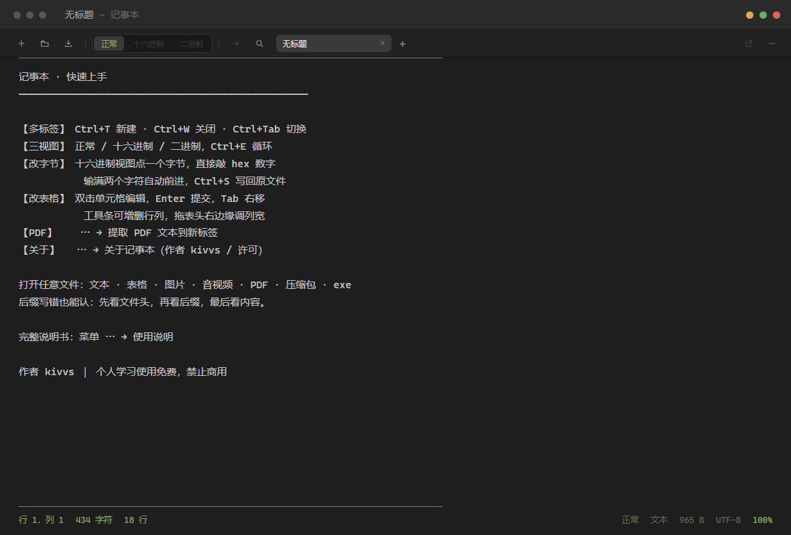
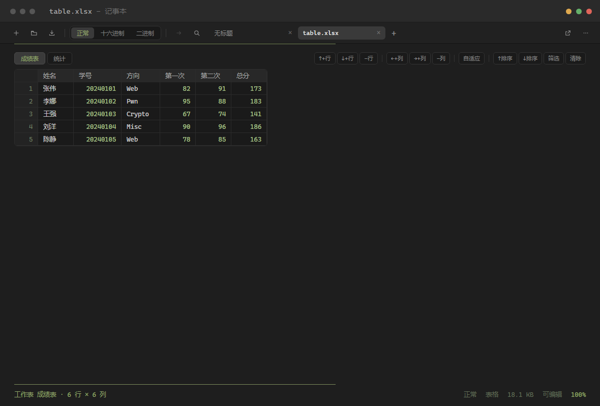
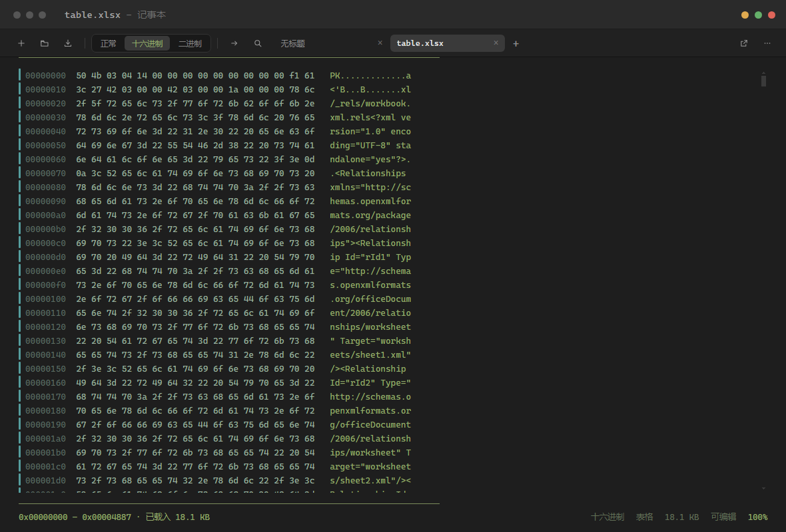

# KivNote

> 深色 macOS 风格的多功能记事本 —— 文本、表格、Word、PPT、PDF、二进制，一个窗口全看。

作者：**kivvs** ｜ 许可：个人使用免费，**禁止商用**（见 [LICENSE](LICENSE)）



---

## 它解决什么问题

Windows 自带的记事本只能看纯文本，看个 Excel 要开 Excel，看个 PDF 要开阅读器，
遇到 `.doc` 老格式还得先找 Office 另存为。

KivNote 把这些收进一个窗口：拖进去就能看，看不了的就用十六进制看字节，
表格能直接改，二进制能直接改字节再写回。

界面风格来自一张截图：近黑底 + 等宽字体 + 橄榄绿细线。等宽只是排版风格，和文件内容无关。

---

## 功能

### 文本

- 100+ 种后缀按文本打开，UTF-8 / GBK 自动识别
- 查找替换、字号缩放、自动换行
- 可编辑、可保存

### 表格（可编辑）



- xlsx / xlsm / xls / csv / tsv / ods
- 双击改单元格，`Enter` 提交、`Tab` 右移
- 工具条增删行列、拖表头改列宽、点表头排序、按列筛选
- 保存时 CSV 正确转义；xlsx 重建改动过的工作表

### Word / PowerPoint / PDF

- `.docx .doc .pptx .ppt` 由**内置排版引擎**转成 PDF 渲染，版式与打印效果一致
- `.pdf` 支持翻页、缩放、适宽、提取文本层、导出指定页、旋转另存

### 十六进制（仿 010 Editor）



- 每行 16 字节：偏移 + 十六进制 + ASCII
- **点击字节直接改**，输满两个 hex 字符自动前进，改过的显示橙色
- `Ctrl+G` 跳到任意偏移，`Ctrl+F` 搜字节序列（`0x504b0304`）或 ASCII
- 左侧彩色竖条标注文件结构：PNG 的 IHDR/IDAT、ZIP 的内部文件、PE 的节表
- 写回只改被改动的那几个字节（`r+` 随机写），不重写整个文件

### 其它

- 多标签（`Ctrl+T` / `Ctrl+W` / `Ctrl+Tab`）
- 三视图切换（正常 / 十六进制 / 二进制），`Ctrl+E`
- 撤销重做，覆盖表格和字节编辑
- 图片 / 音频 / 视频预览
- 任意后缀：先看文件头，再看后缀，最后看内容 —— 后缀写错也能认

---

## 快速开始

### 下载即用

| 形式 | 说明 |
|---|---|
| `KivNote-3.0.0-win64.zip` | 绿色版，解压一次，之后启动 1~3 秒 **（推荐）** |
| `KivNote-3.0.0-portable.exe` | 单文件，每次启动要解压 261 MB，**较慢** |

首次运行会被 Windows SmartScreen 拦一下（没有代码签名），点「更多信息 → 仍要运行」。

### 从源码构建

```bash
npm install

# 可选：内置 Office 转换引擎（750 MB，不装也能跑，但 doc/docx/ppt/pptx 会降级）
npm run fetch:loffice

npm start          # 开发运行
npm run dist       # 打包单文件 exe
npm run pack       # 打绿色版 zip
```

---

## 内置转换引擎

`.doc / .docx / .ppt / .pptx / .xls` 用的是内置的 LibreOffice 26.8.1（裁剪后 756 MB）：

```
文档 → soffice --headless --convert-to pdf → PDF.js 渲染
```

**好处**：收件人不需要装 Office 或 WPS。
**代价**：安装包变成 261 MB。

第一次转换约 10~20 秒（引擎冷启动），之后按「路径 + 大小 + 修改时间」缓存到 `%TEMP%\notepad-lo-cache`，再打开秒开。

> 仓库里不含 LibreOffice（750 MB 不适合进 git）。
> 跑 `npm run fetch:loffice` 会自动下载 MSI、解包、裁剪到 756 MB。

---

## 快捷键

| 功能 | 快捷键 |
|---|---|
| 打开 / 保存 / 另存为 | `Ctrl+O` / `Ctrl+S` / `Ctrl+Shift+S` |
| 新建标签 / 关闭标签 | `Ctrl+T`（或 `Ctrl+N`）/ `Ctrl+W` |
| 标签切换 | `Ctrl+Tab` / `Ctrl+Shift+Tab` |
| 查找 / 替换 | `Ctrl+F` / `Ctrl+H` |
| 循环切换三视图 | `Ctrl+E` |
| 跳到文件偏移 | `Ctrl+G` |
| 撤销 / 重做 | `Ctrl+Z` / `Ctrl+Y` |
| 新窗口 | `Ctrl+Shift+N` |
| 使用说明 | `F1` |

---

## 项目结构

```
main.js                主进程：文件读取、类型判定、字节读写、Office 转换、窗口与 IPC
preload.js             contextBridge 暴露给渲染进程的 API
renderer/
  index.html           整个界面（样式 + 逻辑，单文件）
  sheetjs.js           SheetJS（表格解析/写回）
  pdf.js / pdf.worker.js   PDF.js（PDF 渲染与取文本）
  pdflib.js            pdf-lib（PDF 页面操作）
  help.md              内置使用说明（F1 打开）
build/icon.ico         应用图标
scripts/
  fetch-loffice.py     下载并裁剪 LibreOffice
  make-zip.py          打绿色版 zip
testfiles/             各类测试文件
docs/screenshots/      README 截图
```

技术栈：Electron 33 + 原生 JS（无框架）。渲染层没引任何 UI 库，全部手写 CSS。

更细的开发笔记见 [README.dev.md](README.dev.md)。

---

## 已知限制

- **没有代码签名**，Windows SmartScreen 会提示，杀软可能误报
- 只支持 **Windows 10/11 x64**
- xlsx 写回会**丢样式**（字体颜色、合并单元格、图表、公式），只保留值
- PDF 是页面渲染，能看能框选，但不能改正文
- 十六进制写回和表格保存**直接改原文件、没有自动备份**（设置里可开启写前备份 `.bak`）

---

## 致谢

- [Electron](https://www.electronjs.org/)
- [SheetJS](https://sheetjs.com/)
- [PDF.js](https://mozilla.github.io/pdf.js/)
- [pdf-lib](https://pdf-lib.js.org/)
- [adm-zip](https://github.com/cthackers/adm-zip)
- [LibreOffice](https://www.libreoffice.org/)
